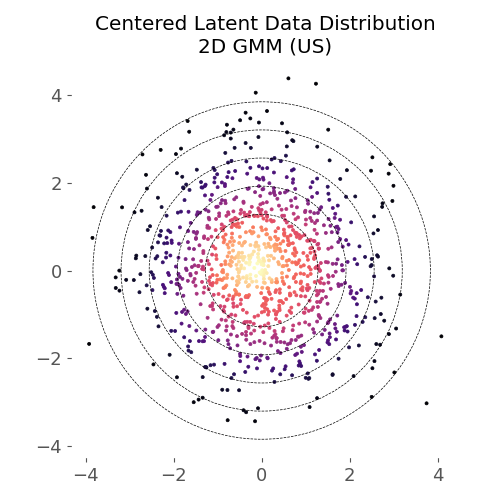
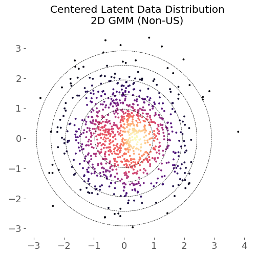

# CJD-Flows: Constant-Jacobian-Determinant Flows

CJD-Flows is a PyTorch library of normalizing flows whose Jacobian determinant
is **constant**: `log|det J_f(x)|` does not depend on `x`. We call this model
class **uniformly scaling flows (US flows)**.

A constant determinant gives three things:

* **Exact, cheap likelihoods.** `log p(x) = log p_Z(f(x)) + C`, where `C` is a
  single learnable scalar.
* **Density level-set preservation.** Data-space density level sets are exactly
  the pre-images of latent level sets. With a radial base, the latent norm
  ranks inputs by density, which gives faithful anomaly scores and verifiable
  density constraints.
* **Stable training.** Additive and volume-preserving layers do not suffer
  from exploding or vanishing Jacobians.

The library's main ingredient is a **learnable radial base distribution**. By
Draxler et al. (ICML 2024), volume-preserving flows with a fixed base are not
universal: the distribution of density values is invariant under them. A
learnable 1-D norm distribution of an Lp-radial base removes exactly this
obstruction while keeping the level-set geometry intact.


## Installation

```bash
pip install cjd-flows                 # core: torch + numpy only
pip install "cjd-flows[eval,onnx]"    # + scipy/sklearn/matplotlib, ONNX export
pip install "cjd-flows[experiments]"  # + the YAML/Ray experiment framework and the legacy pyro API
```

For development (uses [uv](https://docs.astral.sh/uv/)):

```bash
uv sync                      # dev environment incl. pytest/ruff
uv run pytest -m "not slow"
```

## Quickstart

```python
import torch
from cjd_flows import USFlow, fit
from cjd_flows.data.toy import make_toy

x = make_toy("two_moons", 20_000)
flow = USFlow((2,), blocks=8, base="ggmix")      # learnable radial base (generalized-gamma mixture)
fit(flow, x, epochs=30, lr=1e-3, ema_decay=0.999)

flow.log_prob(x[:5])          # exact log-density
flow.sample((1000,))          # samples
flow.log_abs_det()            # THE Jacobian log-determinant -- one scalar for all inputs
```

Images use the same builder (ConvNet conditioners by default):

```python
flow = USFlow((1, 28, 28), blocks=8, hidden=(128, 128), base="ggmix")
```

and a verification-friendly preset gives piecewise-affine flows with an L1-radial
base whose density level sets are polytopes:

```python
from cjd_flows import VeriFlow
flow = VeriFlow((1, 10, 10))           # ReLU conditioners, adjoint LU blocks, monotone L1 base
assert flow.is_piecewise_affine()
```

## Core concepts

| Concept | API |
|---|---|
| Bijection contract | `Bijection.forward(x, context) -> z` (data → latent), `.inverse(z, context)`, `.log_abs_det()` returns a 0-dim tensor that is **constant in x** |
| Composition | `Chain(*bijections)`, `b.inv` |
| Flow | `Flow(bijection, base)`: `log_prob`, `sample`, `rsample`, `transform`, `generate`, `log_abs_det` |
| Training | `cjd_flows.fit(...)`: AdamW, warmup + cosine, EMA, validation and early stopping, bf16, noise augmentation and soft training |
| Testing | `cjd_flows.testing.check_bijection(layer, x)`: inverse, log-det vs autograd, constancy and gradients for your own layers |

### Building blocks (`cjd_flows.bijections`)

| Block | Determinant | Piecewise affine* | Notes |
|---|---|---|---|
| `SplitAdditiveCoupling` | 1 | ✓ | NICE/Jet-style split (channel, checkerboard, row/col, random) |
| `MaskedAdditiveCoupling` | 1 | ✓ | Masked formulation of the original USFlows |
| `GINCoupling` | 1 | ✗ | Affine coupling with zero-sum, bounded log-scale (Sorrenson et al. 2020) |
| `ShiftAutoregressive` | 1 | ✓ | MADE shifts: more expressive than coupling; inverse is sequential |
| `MaskedConvAutoregressive` | 1 | ✓ | PixelCNN-style shift layer (experimental) |
| `LULinear` | free / 1 (`unit_det=True`) | ✓ | One-star (1×1) channel mixing; log-normal prior on the diagonal |
| `HouseholderLinear`, `OrthogonalLinear` (Cayley / exp) | ±1 | ✓ | Isometric mixing, condition number 1 |
| `ActNorm` | free / 1 (`zero_sum=True`) | ✓ | Data-dependent initialization |
| `GlobalScale` | `D·log s` | ✓ | The single "uniform scaling" parameter |
| `Squeeze`, `HaarWavelet`, `Patchify`, `Permutation` | ±1 | ✓ | Reshapes and orthonormal transforms |

\*Given piecewise-affine (ReLU) conditioners. `merge_linear` collapses
consecutive linear layers for export.

Conditioners (`cjd_flows.conditioners`) are `MLP`, `ConvNet` (1–3D, optionally
gated), `MADE` and `JetConditioner` (ViT with adaLN-zero context). All of them
zero-initialize their output, so every coupling starts as the identity. They
optionally use spectral normalization, and `lipschitz_upper_bound` then gives
certified bi-Lipschitz bounds `1 + L` for additive couplings.

### Base distributions (`cjd_flows.radial`)

An Lp-radial base is `p(z) = p_R(‖z‖_p) / (d V_p ‖z‖_p^{d-1})`, valid for any
`p > 0`, with a learnable norm distribution `p_R`:

| Norm distribution | Radial profile | Notes |
|---|---|---|
| `GeneralizedGamma(Mixture)` | monotone iff `a ≤ d` (`monotone=True` ties `a = d`) | contains Gamma, Weibull, Chi and the p-generalized normal |
| `KhinchineNorm` | always monotone | `R = C·U^{1/d}`: every radially decreasing density is a mixture of uniform balls |
| `MonotoneProfileNorm` | always monotone | `−log h` is a learnable increasing function |
| `SplineNorm` | flexible | rational-quadratic spline on the standardized log-radius |
| `StudentTNorm` | monotone | heavy tails |
| `LogNormalMixture` | **never monotone** ("shell") | kept for compatibility |

`RadialMixture` places several radial components at learnable centres. It is
the only base that can change the number of modes, which no volume-preserving
flow can do. `cjd_flows.radial.levelsets` provides `udl_radius`,
`hdr_pvalue`, `density_threshold_radius` and `udl_intervals`: the exact latent
level sets that verification and calibrated anomaly scores need.

**Why monotone profiles matter.** Upper density level sets are norm *balls*
(polytopes for p = 1 and p = ∞) only if the radial profile is decreasing.
LogNormal norm distributions, for example, produce ring-shaped level sets. By
rearrangement theory, monotone profiles lose no expressivity in the
approximation sense.

## Latent-space alignment

Uniformly scaling flows preserve upper density level sets: data-space density
level sets map onto latent norm level sets. The 2D GMM example below colours
latent representations by the data density.

| US flow | Non-US flow |
|---|---|
|  |  |

For the US flow, density decreases monotonically with the latent norm. For a
non-US flow, high-density regions are skewed against the latent geometry.

## Applications

* **Density estimation** with exact likelihoods: `fit`, `evaluate_nll`,
  bits/dim utilities in `cjd_flows.data.preprocess`. Affine preprocessing keeps
  the constant determinant; logit preprocessing does not.
* **Anomaly / OOD detection**: `cjd_flows.scores.anomaly_scores` returns NLL,
  latent norm, typicality `−log p_R(‖z‖)` and the HDR p-value, together with
  AUROC, AUPR and FPR@95 metrics.
* **Neural network verification** (VeriFlow): train a piecewise-affine US flow
  as a proxy density, take a latent upper density level set, which is a norm
  ball, and verify properties over its image. `cjd_flows.export.to_onnx`
  exports `log_prob` / `forward` / `inverse` graphs.

## Benchmarks

`benchmarks/` contains the CPU density suite (`benchmarks/density/run.py`: toy
2-D data, the asymmetric GMM of the USF paper and the MAF tabular suite) and the
CIFAR-10 scaling study (`benchmarks/cifar/`). Results are summarized in
`docs/benchmarks.md`.

## Legacy API

The pyro-based API of v0.9 (`cjd_flows.flows.USFlow`,
`cjd_flows.transforms`, `cjd_flows.distributions`, `cjd_flows.explib`) is still
available with the `[legacy]` / `[experiments]` extras, and its known bugs are
fixed. New code should use the v1 API above.

```bash
python scripts/run-experiment.py --config <config file> --report_dir <log dir>
```

## Citation

If you use this library, please cite the VeriFlow paper:

> Zaid, F. A., Neider, D., and Yalciner, M. (2026). VeriFlow: Modeling Distributions for Neural Network Verification. *Proceedings of the AAAI Conference on Artificial Intelligence*, 40(33), 28050-28058. https://doi.org/10.1609/aaai.v40i33.40030

GitHub citation support and downloadable formats:

- [`CITATION.cff`](CITATION.cff) (for GitHub's "Cite this repository" widget)
- [`CITATION.bib`](CITATION.bib) (downloadable BibTeX)

<details>
<summary>BibTeX</summary>

```bibtex
@article{Zaid_Neider_Yalciner_2026,
  title   = {VeriFlow: Modeling Distributions for Neural Network Verification},
  author  = {Zaid, Faried Abu and Neider, Daniel and Yal{\c{c}}iner, Mustafa},
  journal = {Proceedings of the AAAI Conference on Artificial Intelligence},
  volume  = {40},
  number  = {33},
  pages   = {28050--28058},
  year    = {2026},
  month   = mar,
  doi     = {10.1609/aaai.v40i33.40030},
  url     = {https://ojs.aaai.org/index.php/AAAI/article/view/40030}
}
```

</details>

## References

* Draxler, Wahl, Schnörr, Köthe (2024). *On the Universality of Volume-Preserving and Coupling-Based Normalizing Flows.* ICML.
* Dinh, Krueger, Bengio (2015). *NICE: Non-linear Independent Components Estimation.*
* Sorrenson, Rother, Köthe (2020). *Disentanglement by Nonlinear ICA with General Incompressible-flow Networks (GIN).* ICLR.
* Kolesnikov, Susano Pinto, Tschannen (2024). *Jet: A Modern Transformer-Based Normalizing Flow.*
* Zhai et al. (2025). *Normalizing Flows are Capable Generative Models (TarFlow).* ICML.
* Kingma & Dhariwal (2018). *Glow.* NeurIPS. Papamakarios et al. (2017). *MAF.* NeurIPS.

## Acknowledgment

<picture>
  <source media="(prefers-color-scheme: dark)" srcset="docs/images/logos/baiaa-logo.svg">
  
</picture>

The Bavarian AI Act Accelerator is a two-year project funded by the Bavarian
State Ministry of Digital Affairs to support SMEs, start-ups, and the public
sector in Bavaria in complying with the EU AI Act. Under the leadership of the
appliedAI Institute for Europe and in collaboration with Ludwig Maximilian
University, the Technical University of Munich, and the Technical University of
Nuremberg, training, resources, and events are being offered. The project
objectives include reducing compliance costs, shortening the time to compliance,
and strengthening AI innovation. To achieve these objectives, the project is
divided into five work packages: project management, research, education, tools
and infrastructure, and community.
