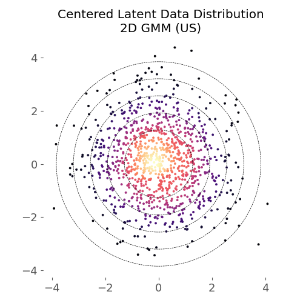
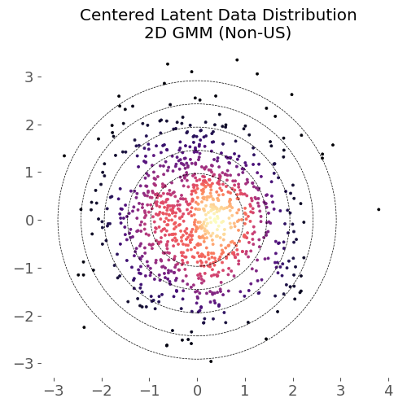

# Core concepts

| Concept | API |
|---|---|
| Bijection contract | `Bijection.forward(x, context) -> z` (data → latent), `.inverse(z, context)`, `.log_abs_det()` returns a 0-dim tensor that is **constant in x** |
| Composition | `Chain(*bijections)`, `b.inv` |
| Flow | `Flow(bijection, base)`: `log_prob`, `sample`, `rsample`, `transform`, `generate`, `log_abs_det` |
| Training | {func}`cjd_flows.fit <cjd_flows.train.fit>`: AdamW, warmup + cosine, EMA, validation and early stopping, bf16, noise augmentation and soft training |
| Testing | {func}`cjd_flows.testing.check_bijection`: inverse, log-det vs autograd, constancy and gradients for your own layers |

See {doc}`design` for the full contract and the conventions.

## Building blocks

All layers live in {mod}`cjd_flows.bijections`.

| Block | Determinant | Piecewise affine* | Notes |
|---|---|---|---|
| `SplitAdditiveCoupling` | 1 | ✓ | NICE/Jet-style split (channel, checkerboard, row/col, random) |
| `MaskedAdditiveCoupling` | 1 | ✓ | Masked formulation of the original USFlows |
| `GINCoupling` | 1 | ✗ | Affine coupling with zero-sum, bounded log-scale (Sorrenson et al. 2020) |
| `ShiftAutoregressive` | 1 | ✓ | MADE shifts: more expressive than coupling; inverse is sequential |
| `MaskedConvAutoregressive` | 1 | ✓ | PixelCNN-style shift layer (experimental) |
| `TransformerAutoregressive` | 1 | ✗ | Causal transformer over tokens (TarFlow-style); shift or zero-sum scale + shift; KV-cached inverse |
| `LULinear` | free / 1 (`unit_det=True`) | ✓ | One-star (1×1) channel mixing; log-normal prior on the diagonal |
| `HouseholderLinear`, `OrthogonalLinear` (Cayley / exp) | ±1 | ✓ | Isometric mixing, condition number 1 |
| `ActNorm` | free / 1 (`zero_sum=True`) | ✓ | Data-dependent initialization |
| `GlobalScale` | `D·log s` | ✓ | The single "uniform scaling" parameter |
| `Shift` | 1 | ✓ | Per-coordinate bias, initialized to centre the latents of the first batch |
| `Squeeze`, `HaarWavelet`, `Patchify`, `Permutation` | ±1 | ✓ | Reshapes and orthonormal transforms |

\*Given piecewise-affine (ReLU) conditioners. `merge_linear` collapses
consecutive linear layers for export.

Conditioners ({mod}`cjd_flows.conditioners`) are `MLP`, `ConvNet` (1–3D,
optionally gated), `MADE` and `JetConditioner` (ViT with adaLN-zero context).
All of them zero-initialize their output, so every coupling starts as the
identity. They optionally use spectral normalization, and
`lipschitz_upper_bound` then gives certified bi-Lipschitz bounds `1 + L` for
additive couplings.

## Base distributions

An Lp-radial base ({mod}`cjd_flows.radial`) is

$$
p(z) = \frac{p_R(\|z\|_p)}{d\, V_p\, \|z\|_p^{d-1}},
$$

valid for any $p > 0$, with a learnable norm distribution $p_R$:

| Norm distribution | Radial profile | Notes |
|---|---|---|
| `GeneralizedGamma(Mixture)` | monotone iff `a ≤ d` (`monotone=True` ties `a = d`) | contains Gamma, Weibull, Chi and the p-generalized normal |
| `KhinchineNorm` | always monotone | `R = C·U^{1/d}`: every radially decreasing density is a mixture of uniform balls |
| `MonotoneProfileNorm` | always monotone | `−log h` is a learnable increasing function |
| `SplineNorm` | flexible | rational-quadratic spline on the standardized log-radius |
| `StudentTNorm` | monotone | heavy tails |
| `LogNormalMixture` | **never monotone** ("shell") | kept for compatibility |

`RadialMixture` places several radial components at learnable centres. It is
the only base that can change the number of modes, which no volume-preserving
flow can do. {mod}`cjd_flows.radial.levelsets` provides `udl_radius`,
`hdr_pvalue`, `density_threshold_radius` and `udl_intervals`: the exact latent
level sets that verification and calibrated anomaly scores need.

**Why monotone profiles matter.** Upper density level sets are norm *balls*
(polytopes for p = 1 and p = ∞) only if the radial profile is decreasing.
LogNormal norm distributions, for example, produce ring-shaped level sets. By
rearrangement theory, monotone profiles lose no expressivity in the
approximation sense.

## Latent-space alignment

Uniformly scaling flows preserve upper density level sets: data-space density
level sets map onto latent norm level sets. The 2D GMM example below colours
latent representations by the data density.

| US flow | Non-US flow |
|---|---|
|  |  |

For the US flow, density decreases monotonically with the latent norm. For a
non-US flow, high-density regions are skewed against the latent geometry.
